<div align="center">


<br>


<a href="#-license"></a>

</div>

<br>


> *"No engine. No mercy. Just rays."*

**Blood Sector** is a retro-inspired first-person horror shooter built in **C++** with **Raylib** and classic **raycasting**. Inspired by early FPS games like Doom, it renders a pseudo-3D world entirely through a custom raycaster, with no game engine underneath.

Fight through four sectors, learn how each monster hunts you, scavenge ammo, and survive a boss at the bottom of it all.


<br>

<p align="center">
  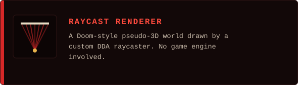
  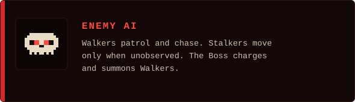
  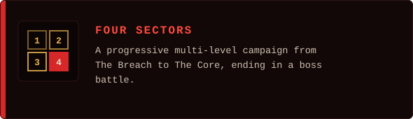
  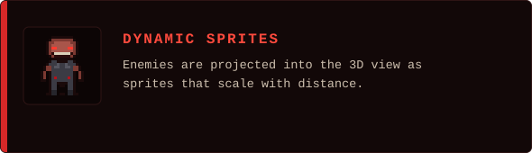
  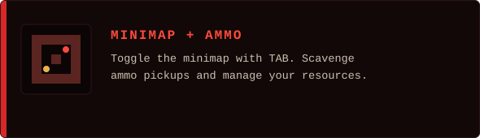
  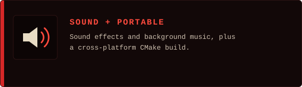
</p>

<br>


<p align="center">
  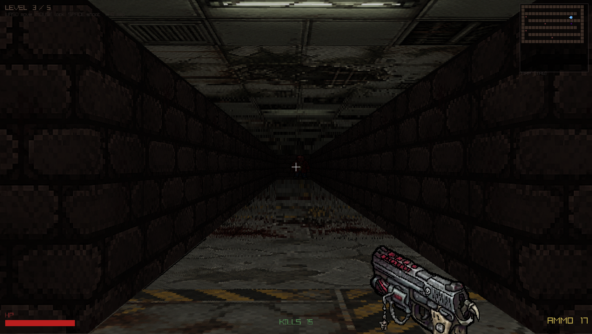
  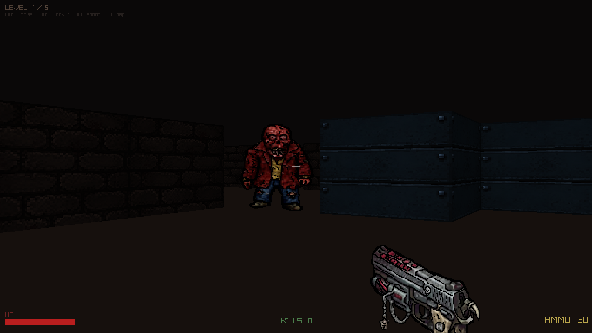
  <br>
  <sub><i>Figure 1: Real in-engine captures from the raycaster.</i></sub>
</p>

<br>


Three kinds of things want you dead. Each one needs a different answer.


<sub><i>Sprites and state chips above are redrawn illustrations of the behavior, not in-game assets.</i></sub>

| Enemy | Health | Behavior |
| :--- | :---: | :--- |
| **Walker** | 3 HP | Random patrol, chase, melee attack |
| **Stalker** | 5 HP | Moves only when not being observed |
| **Boss** | 20 HP | Charge attacks and summons Walkers |

<br>



<sub><i>The layouts above are simplified sketches of each sector's character, not the real level maps.</i></sub>

| Sector | Description |
| :--- | :--- |
| **The Breach** | Introduction to core mechanics |
| **The Corridor** | Tight spaces and ambush encounters |
| **The Labyrinth** | Maze-like navigation challenge |
| **The Core** | Final boss arena |

<br>


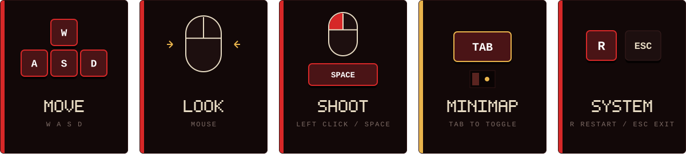

| Key | Action |
| :--- | :--- |
| `W` `A` `S` `D` | Move |
| `Mouse` | Look around |
| `Left Click` / `Space` | Shoot |
| `TAB` | Toggle minimap |
| `R` | Restart level |
| `ESC` | Exit game |

<br>


Every frame is built from scratch. A ray is cast for each column of the screen, a **DDA** walks the grid from line to line until it hits a wall, and the hit distance decides how tall that wall slice is drawn. Sprites are then projected on top.

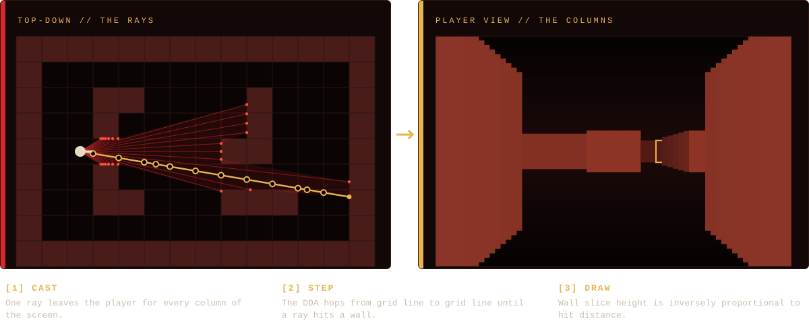

<sub><i>A simplified illustration of the technique, not a capture from the game.</i></sub>

The code is split into small, object-oriented modules built around an abstract `Entity` base class:

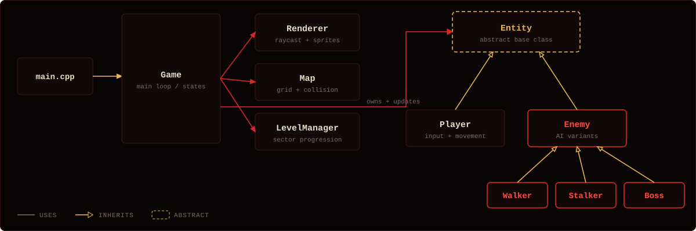

<sub><i>Simplified relationships between the modules. See <code>src/</code> for the real thing.</i></sub>

| Technique | What it does here |
| :--- | :--- |
| **Object-oriented design** | Game, renderer, map, player, enemies and levels live in separate classes |
| **Inheritance and polymorphism** | Player and enemies share an abstract `Entity` interface |
| **Dynamic enemy management** | Enemies are created, updated and removed as the level plays out |
| **DDA raycasting** | Finds the first wall hit for every screen column |
| **Sprite projection** | Places enemies and pickups into the 3D view |
| **Collision detection** | Keeps the player and enemies out of walls |
| **State-based architecture** | The game flow is driven by explicit states |

<br>


**Requirements:** a C++17 compatible compiler and CMake 3.15+.

```bash
# Clone the repository
git clone https://github.com/abduhoo-bin-nasir/Blood-Sector.git
cd Blood-Sector
```

**Configure**

```bash
# Windows (MinGW)
cmake -B build -G "MinGW Makefiles"

# Linux / macOS
cmake -B build
```

**Build**

```bash
cmake --build build
```

**Run**

```bash
# Windows
./build/Blood-Sector.exe

# Linux / macOS
./build/Blood-Sector
```

> [!NOTE]
> Copy the `assets/` folder into the build directory before running the executable.

<details>
<summary><b>Project structure</b></summary>

```text
blood-sector/
│
├── src/
│   ├── main.cpp
│   ├── Game.h / Game.cpp
│   ├── Renderer.h / Renderer.cpp
│   ├── Player.h / Player.cpp
│   ├── Enemy.h / Enemy.cpp
│   ├── Entity.h / Entity.cpp
│   ├── Map.h / Map.cpp
│   └── LevelManager.h / LevelManager.cpp
│
├── assets/
│   ├── sprites/
│   ├── sounds/
│   ├── music/
│   └── screenshots/
│
├── CMakeLists.txt
├── README.md
└── BUILD.md
```

</details>

<br>

## 📜 License

This project is licensed under the MIT License.

<br>


<p align="center"><sub>Built by <a href="https://abduhoo-bin-nasir.github.io">Abduhoo Bin Nasir</a> &nbsp;·&nbsp; <a href="https://github.com/abduhoo-bin-nasir">GitHub</a></sub></p>
